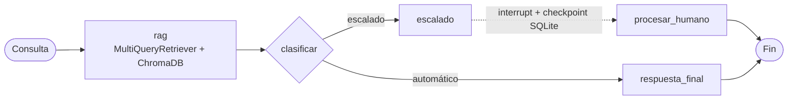

# Helpdesk 2.0 — RAG + LangGraph

Sistema de mesa de ayuda que responde tickets de soporte de forma automática con RAG y escala a un agente humano cuando la base de conocimiento no alcanza. El flujo está modelado como un grafo de LangGraph con checkpoints persistentes, lo que permite pausar un ticket, esperar la respuesta humana y reanudarlo.

> Basado en un proyecto del curso de LangChain/LangGraph, migrado de las primeras versiones de LangChain a **LangChain 1.x**, **Python 3.14** y gestión de dependencias con **uv**.

## Qué hace

- **Recuperación multi-query:** un `MultiQueryRetriever` genera tres reformulaciones de cada consulta con GPT-4o-mini y busca en ChromaDB, para no depender de cómo escribió el usuario.
- **Respuestas con fuentes:** la respuesta se genera solo con el contexto recuperado y muestra los documentos consultados.
- **Clasificación automático / escalado:** un nodo del grafo decide si la respuesta es suficiente o si el ticket necesita a una persona.
- **Human-in-the-loop:** los tickets escalados se detienen con `interrupt_before` y su estado se guarda en SQLite; el agente responde desde la interfaz y el grafo continúa desde el checkpoint.
- **Interfaz en Streamlit:** creación de tickets, traza de cada paso, confianza, fuentes y métricas de resolución (RAG vs. humano).

## Arquitectura



**Ingesta (`setup_rag.py`):** documentos Markdown de `docs/` → `RecursiveCharacterTextSplitter` (chunks de 1000, traslape 200) → embeddings `text-embedding-3-large` → colección `helpdesk_knowledge` en ChromaDB.

## Stack

| Componente | Tecnología |
| --- | --- |
| Orquestación | LangGraph (`StateGraph`, `SqliteSaver`) |
| RAG | LangChain 1.x, `langchain-classic` (MultiQueryRetriever) |
| Vector store | ChromaDB |
| Modelos | OpenAI `gpt-4o-mini`, `text-embedding-3-large` |
| Interfaz | Streamlit |
| Entorno | Python 3.14, uv |

## Estructura

```
├── app.py              # Interfaz Streamlit
├── graph.py            # Grafo de LangGraph: estado, nodos y enrutamiento
├── rag_system.py       # Recuperación multi-query, generación y confianza
├── setup_rag.py        # Ingesta: carga, chunking y creación del vector store
├── config.py           # Rutas y modelo de embeddings
└── docs/               # Base de conocimiento (FAQ, manual, guía de problemas)
```

## Cómo correrlo

Requisitos: [uv](https://docs.astral.sh/uv/) y una API key de OpenAI.

```bash
git clone <url-del-repo>
cd helpdesk_system
uv sync

cp .env.example .env      # agrega tu OPENAI_API_KEY
```

```bash
uv run python setup_rag.py   # crea el vector store a partir de docs/
uv run streamlit run app.py
```

La app abre en `http://localhost:8501`. También puedes crear el vector store desde el botón **Reconfigurar RAG** de la barra lateral.

## Limitaciones y siguientes pasos

- La confianza es una heurística (coincidencia de palabras clave entre consulta y chunks). El siguiente paso es usar los scores de relevancia del vector store o un reranker.
- No hay un set de evaluación todavía; la idea es medir recuperación y fidelidad (por ejemplo con RAGAS) y la tasa de escalado correcto.
- Para producción: checkpointer en Postgres, vector store en servidor, API separada de la interfaz y autenticación de agentes.
